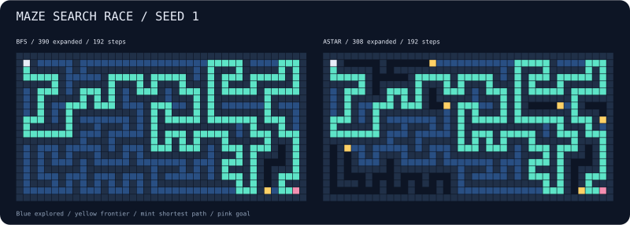

# maze-search-race

Two search algorithms. One maze. Watch breadth-first search flood the corridors while A* follows a heuristic toward the goal. Same shortest path, different exploration.



## Run

```bash
npx --yes github:b69ca/maze-search-race --seed 1
npx --yes github:b69ca/maze-search-race --seed 137 --delay 10
```

Node.js 20 or newer. No runtime dependencies. Nothing is fetched or sent during a race.

## Play

| Key | Action |
| --- | --- |
| `p` or Space | Pause / resume |
| `n` | Generate the next seed |
| `r` | Restart the same race |
| `+` / `-` | Faster / slower animation |
| `q` or Ctrl-C | Quit and restore the terminal |

Each animation tick expands at most one cell per unfinished search. After both finish, the view stays open so you can inspect it or start another race.

| Symbol | Meaning |
| --- | --- |
| `#` | Wall |
| `.` | Explored cell |
| `+` | Frontier |
| `*` | Final path |
| `S` / `G` | Start / goal |

The header counts expanded cells, including the goal. This is a race in search work, not a wall-clock performance benchmark. A* uses Manhattan distance and deterministic tie-breaking; it is not guaranteed to expand fewer cells on every maze.

## Reproduce and export

```bash
npx --yes github:b69ca/maze-search-race --seed 1 --json
npx --yes github:b69ca/maze-search-race --seed 1 --svg maze.svg
npx --yes github:b69ca/maze-search-race --seed 1 > solved.txt
```

JSON includes the dimensions, seed, open-cell count, and both results with expanded counts, path lengths, and paths. Paths contain zero-based row-major cell IDs: `id = y * width + x`. Path length is the number of moves, not the number of cells.

## Options

```text
--seed N       unsigned 32-bit seed (default: 42)
--width N      odd integer from 9 to 101
--height N     odd integer from 9 to 101
--delay MS     animation tick delay from 0 to 1000 (default: 20)
--json         solve immediately and print the results
--svg FILE     solve immediately and save a static SVG
--no-color     disable ANSI colors
--help         show usage
```

JSON and SVG can be combined. Noninteractive output defaults to a 41 × 21 maze, solves immediately, and prints a plain final view. Live defaults shrink to fit the terminal at startup, so specify dimensions if reproducing the same maze across different terminals. A seed reproduces a maze only with the same dimensions. Explicit large dimensions require a larger terminal. `NO_COLOR=1` also disables colors.

## Under the hood

An iterative randomized depth-first generator creates a perfect maze: every open cell is connected, and there are no loops. The seed controls a local deterministic PRNG; it does not modify global randomness. BFS uses a FIFO queue. A* orders its frontier by distance-so-far plus Manhattan distance, then remaining distance, then insertion order.

Both algorithms support custom unweighted four-neighbor grids, including cycles and unreachable goals. They return shortest paths when a goal is reachable. Generated mazes always have a route.

## Library

```js
import { createMaze, createSearch, step, analyze } from 'maze-search-race';
const maze = createMaze({ width: 41, height: 21, seed: 1 });
const search = createSearch(maze, 'astar');
step(search, 20); // Mutates search; inspect its frontier and explored sets.
console.log(analyze(maze)); // Solve both independently and compare.
```

Clone the repository and run `npm ci` followed by `npm run check`. Tests check connectivity, acyclicity, valid shortest paths across seeds, cyclic and unreachable grids, CLI behavior, and SVG exports. GitHub Actions runs on Node.js 20, 22, and 24.

## License

MIT
